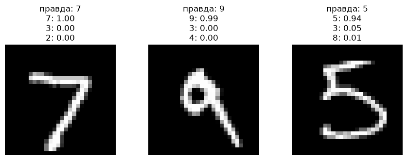

# Распознавание рукописных цифр: MNIST + Gradio

Небольшой учебный проект: сеть 784 → 128 → 10 на MNIST, обучение на процессоре
за минуту и веб-интерфейс, где цифру рисуют мышкой.

## Что внутри

```
project15/
├── train.py         обучение на MNIST (3 эпохи), сохраняет mnist.pt
├── predict.py       predict(image) → {цифра: вероятность}
├── app.py           интерфейс Gradio: рисуешь цифру — видишь ответ
├── make_example.py  собирает example.png для этого README
├── requirements.txt  зависимости (torch с CPU-индексом)
├── example.png      пример работы predict.py
└── data/            MNIST скачается сюда при первом запуске (12 МБ)
```

## Установка (3 команды)

Windows (PowerShell):
```powershell
python -m venv .venv
.venv\Scripts\activate
pip install -r requirements.txt
```

macOS / Linux:
```bash
python3 -m venv .venv
source .venv/bin/activate
pip install -r requirements.txt
```

В `requirements.txt` уже прописан `--extra-index-url https://download.pytorch.org/whl/cpu`,
поэтому ставится лёгкая CPU-сборка torch, без CUDA.

## Запуск

```powershell
python train.py     # 3 эпохи, ~1 минута на CPU, сохраняет mnist.pt
python app.py       # интерфейс на http://127.0.0.1:7860
```

Открыть http://127.0.0.1:7860, нарисовать цифру мышкой — справа появятся три
самых вероятных ответа с вероятностями.

## Пример работы



Скриншот самого интерфейса: после запуска `python app.py` сделай снимок окна и
положи рядом как `screenshot.png` — это и есть картинка для README.

## Ограничения

- Модель знает только цифры 0–9 и только «почерк MNIST»: на аккуратных, крупно
  нарисованных цифрах попадает примерно 7 раз из 10, на кривых каракулях — хуже.
- Рисовать лучше в центре холста и крупно: цифра сжимается до 28×28.
- Светлый фон автоматически инвертируется (`if x.mean() > 0.5: x = 1 - x`).
- Точность на тестовой выборке MNIST — около 0.97 (3 эпохи). Чтобы поднять —
  4–5 эпох или 256 нейронов в скрытом слое, но обучение на CPU станет дольше.
- Всего обучаемых параметров 101 770; файл весов занимает около 400 КБ.
